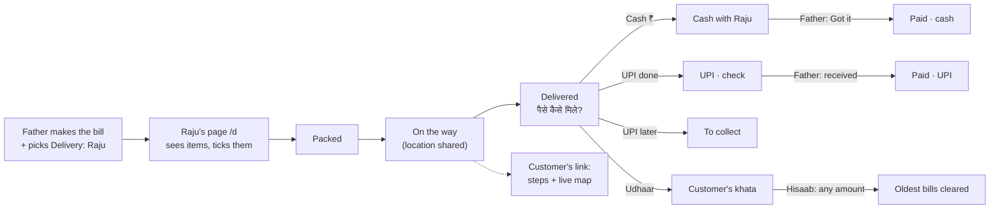

# Delivery and payment tracking

**Why it exists:** "The main pain point of this business is payment collection from the
worker, or knowing what happened with that customer." Cash went missing between the delivery
boy and the shop, and udhaar lived in a notebook ([D051](../decisions/D051-track-delivery-and-money-on-every-bill.md)).

## The two statuses ([`src/tracking.mjs`](../../../src/tracking.mjs))

Every helper is shared by the app, Raju's page, the customer page and the server.

| `deliveryStep(bill)` | Means |
|---|---|
| `none` | No delivery person picked |
| `assigned` | Delivery person picked ("With Raju"); he can see the order |
| `packed` / `onTheWay` / `delivered` | The latest step marked (times in `deliveryEvents`) |

| `paymentState(bill).key` | Label | Counts as |
|---|---|---|
| `none` | — | not delivered, nothing marked |
| `due` | Not paid | **To collect** (delivered, nothing marked) |
| `cashWith` | Cash with Raju | the boy's cash in hand ([D052](../decisions/D052-cash-stays-with-delivery-boy-until-handover.md)) |
| `paidCash` | Paid · cash | in the shop |
| `upiCheck` | UPI · check | **UPI to check** ([D053](../decisions/D053-father-confirms-upi.md)) |
| `paidUpi` | Paid · UPI | in the shop |
| `later` | UPI later | **To collect** |
| `udhaar` | Udhaar | the customer's khata ([D054](../decisions/D054-udhaar-khata-any-amount.md)) |

`paymentStatus = { method: cash|upi|later|udhaar, amount, at, by: owner|delivery, person, handedOverAt?, upiConfirmedAt? }`.
When the **father** marks cash or UPI, it counts as already received (`handedOverAt` or
`upiConfirmedAt` = now).

## Who can change what

| Action | Father (shop PIN) | Delivery boy (own PIN) |
|---|---|---|
| Pick the delivery person | Delivery dropdown on the bill (auto-saved) | — |
| Packed / On the way / Delivered | Tap on the bill; tap again to undo | Next-step button on `/d` (no undo) |
| Payment | Tap a chip; tap again to clear | Once, at Delivered |
| Got the cash | "Got ₹X from Raju" on a bill, or **Got it** on the All bills banner (all his cash) | — |
| UPI received | "UPI ₹X received" on the bill | — |
| Khata payment | Customers tab → customer → amount → Cash/UPI received; Remove to undo | — |

The server enforces this in `applyTracking` (`netlify/lib/bills-api.mjs`): a delivery person
only reaches bills whose `delivery.id` is theirs, and can't clear a payment or undo a step
([D055](../decisions/D055-delivery-boy-page-own-pin.md)).

## Where it is stored ([data model](data-model.md))

- `bills.delivery_events` jsonb and `bills.payment_status` jsonb. Changed only by the
  tracking routes, never by the bill PUT, so auto-save can't overwrite a delivery boy's tap
  ([D057](../decisions/D057-tracking-saved-apart-from-bill-contents.md)).
- `khata_payments (id, customer_key, amount, method, created_at, deleted_at)`: hisaab payments,
  matched to customers through the catalog's merge rules.
- `courier_locations (person_id, lat, lng, accuracy, at)`: one row per person, overwritten.
- Delivery PINs: `settings.delivery[].pinHash` = sha256(`id:pin`), never sent to phones.

## Raju's page (`/d`, [`src/DeliveryApp.jsx`](../../../src/DeliveryApp.jsx))

- **Login:** mobile number + PIN, kept on his phone. The headers are `X-Delivery-Phone` and `X-Delivery-Pin`.
- **Orders:** his open orders, then "Delivered today" (last 12 hours). Each shows address, Call, an item tick list (ticks saved on the phone only), the total and the next-step button.
- **Delivered:** asks "पैसे कैसे मिले?". Cash comes with an amount pre-filled with the total; the other choices are UPI done, UPI later and Udhaar.
- **Refresh:** every 30 s while on screen with open orders ([D058](../decisions/D058-refresh-only-while-on-screen.md)).
- **Location:** while any order is on the way and the page is open, he sends it every 20 s and the screen is kept awake. Notes tell him if location is off or unsupported.

## Customer's link ([`src/PublicBill.jsx`](../../../src/PublicBill.jsx))

- **Status:** steps with times (Received, Packed, On the way with Raju, Delivered), then "To pay ₹X", "Paid · thank you" or "Added to your account (udhaar)". `toPublicBill.paid` collapses the payment into `paid` / `udhaar` / `due`, so customers never see who holds the cash.
- **Live map** ([`src/LiveMap.jsx`](../../../src/LiveMap.jsx)): shown while the order is on the way and Raju's last location is under 3 minutes old. It uses Leaflet with OpenStreetMap tiles (credited) and the map code loads only when needed. It refreshes every 20 s while on screen and disappears once delivered ([D056](../decisions/D056-live-map-while-on-the-way.md)).

## Limits and costs

- **The live location stops when Raju's screen locks.** Browsers suspend hidden pages. The wake lock only keeps the screen on while the page is in front.
- **Cost:** checks and location updates cost Netlify credits and keep Neon awake only while
  someone is actively delivering or watching; see the numbers in
  [D058](../decisions/D058-refresh-only-while-on-screen.md). Watch Neon's usage page after the first weeks.
- **Mistakes:** a mistaken "Got it" (handover) can only be undone in SQL for now
  ([runbook](../operations/runbook.md)).
