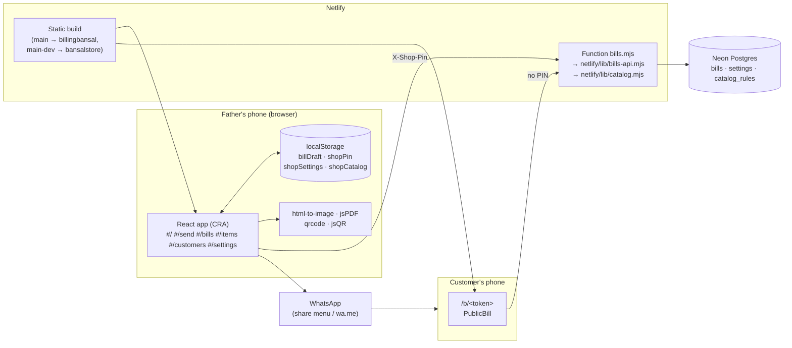

# Architecture overview

A static React app and one Netlify Function in front of a Postgres database. All the
clever parts (the bill picture, PDF, QR codes, fuzzy matching) run in the browser, and the
server stays small.

## Parts

| Part | Files | What it does | Decisions |
|---|---|---|---|
| App shell and state | `src/App.js` | Hash routing, the bill on screen, auto-save, settings and catalog caches, PIN lock | [D015](../decisions/D015-hash-routing.md), [D031](../decisions/D031-auto-save.md) |
| Bill screen | `src/Billing.jsx`, `src/bill.js` | Table editing, chips, spare rows, payment/delivery pickers | [D011](../decisions/D011-phone-fit-rules.md), [D038](../decisions/D038-chips-not-dropdowns.md) |
| Bill sheet | `src/InvoiceSheet.jsx`, `src/shop.js`, `src/QrCode.jsx`, `src/Logo.jsx` | The printed-style bill used on screen, in pictures and on the customer page | [D022](../decisions/D022-bill-design.md) |
| Sending | `src/SendPage.jsx`, `src/share.js` | Picture, share menu, WhatsApp text, PDF | [D030](../decisions/D030-bill-picture-html-to-image.md), [D033](../decisions/D033-view-and-send-two-options.md) |
| All bills | `src/Bills.jsx`, `src/billsFilter.js`, `src/StatusChips.jsx` | List, filters, search | [D020](../decisions/D020-all-bills-cards-with-edit.md) |
| Items / Customers | `src/ItemsPage.jsx`, `src/CustomersPage.jsx`, `src/catalog.js` | Clean-up screens and rule edits | [D040](../decisions/D040-inventory-from-bills-items-customers-tabs.md), [D041](../decisions/D041-cleanup-as-rules-bills-never-change.md) |
| Matching | `src/normalize.mjs` (shared with the server) | Text normalisation, address keys, typo-tolerant scores, customer keys | [D044](../decisions/D044-fuzzy-matching-own-normaliser.md), [D043](../decisions/D043-customer-identity-key.md) |
| Settings | `src/Settings.jsx`, `src/shopSettings.js`, `src/qrPhoto.js` | Payment QRs and delivery people | [D025](../decisions/D025-payment-qr-in-settings.md) |
| Customer page | `src/PublicBill.jsx`, `src/index.js` | `/b/<token>` without the PIN | [D021](../decisions/D021-private-bill-link.md), [D024](../decisions/D024-customer-page-three-actions.md) |
| API client | `src/api.js` | `fetch` wrapper, PIN header, 401 handling, "No internet" errors | [D006](../decisions/D006-no-login-shop-pin.md) |
| API | `netlify/functions/bills.mjs`, `netlify/lib/bills-api.mjs`, `netlify/lib/db.mjs` | Routes, validation, schema, PIN check | [D005](../decisions/D005-api-through-netlify-functions.md), [D012](../decisions/D012-schema-on-first-request.md), [D014](../decisions/D014-one-api-handler-local-and-netlify.md) |
| Catalog builder | `netlify/lib/catalog.mjs` | Items and customers from bills + rules | [D042](../decisions/D042-catalog-built-on-read.md) |
| Local API | `scripts/local-api.mjs` | Same handler on :8787 for development | [D014](../decisions/D014-one-api-handler-local-and-netlify.md) |
| Hosting config | `netlify.toml`, `public/` | Build command, functions folder, `/b/*` rewrite, icons, manifest | [D016](../decisions/D016-netlify-build-command.md), [D028](../decisions/D028-bansal-store-branding.md) |

## Request flow: typing a bill

1. A keystroke updates `draft` in `App.js`, which writes it to `localStorage` (`billDraft`).
2. One second after the last change, if the bill has an item, `saveNow` POSTs
   `/api/bills` (new) or PUTs `/api/bills/:n` (existing), with `X-Shop-Pin`.
3. The function checks the PIN, runs `ensureSchema` once per instance, validates with
   `parseBill` (trims text, recomputes amounts and total on the server), writes, and
   returns the bill.
4. The app records the bill number, updates the top bar and the cached list.

## Request flow: suggestions

1. On unlock (and on opening the tabs, and after New bill), the app GETs `/api/catalog`.
2. The server reads all non-deleted bills and the `catalog_rules` row, and builds
   `{ items, customers }` with `buildCatalog`.
3. The app caches it (`shopCatalog`). Chips are computed locally on every keystroke with
   `suggestItems` / `suggestCustomers`, so they work offline.

## Boundaries worth knowing

- **The server is the authority on amounts.** The client computes amounts for display, and
  `parseBill` recomputes them on save.
- **The server never trusts a bill's shape**: limits on text length (name 120, phone 20,
  address 300, item 120, details 200) and 300 rows. Numbers must be finite and within ±1e9.
- **Shared code**: `src/normalize.mjs` is imported by the browser bundle and by the
  function (`netlify/lib/catalog.mjs` imports `../../src/normalize.mjs`, and Netlify's
  bundler inlines it).

More detail: [data model](data-model.md) · [API](api.md) · [frontend](frontend.md) ·
[picture and sending](bill-picture-and-sending.md) · [matching and catalog](matching-and-catalog.md) ·
[deployment](deployment-and-environments.md) · [security](security-and-privacy.md)
