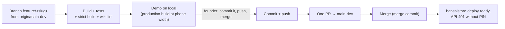

# Release process

**One live site, one branch, one PR.** bansalstore.netlify.app builds from `main-dev`, and
that is the only place changes go ([D050](../decisions/D050-one-live-site-main-dev-only.md)).
The founder approves every step that leaves the machine ([D047](../decisions/D047-branch-demo-ship-workflow.md)).



## Steps

1. `git fetch origin && git switch -c feature/<slug> origin/main-dev`. Don't start from `main`: it is deprecated and stale, even though GitHub still shows it as the default branch.
2. Make the change. **Update the wiki in the same branch**: decision records, affected pages, a `log.md` entry ([conventions](../conventions.md)).
3. Run the [checks](testing.md). Demo locally on the production build (`npm run serve:build`) and tell the founder what was and wasn't tested. There is no separate check site any more, so this is the last check before the father's site.
4. Wait for the founder's words, typically "Commit it, push feature/<slug> and merge".
5. Commit with a message that explains *why*. End it with the co-author line the session asks for.
6. `git push -u origin feature/<slug>`, then:
   ```bash
   gh pr create --repo anubhavb11/Billing --base main-dev --head feature/<slug> --title "…" --body-file pr.md
   gh pr merge <n> --repo anubhavb11/Billing --merge
   ```
   Always pass `--base main-dev`. Without it, `gh` targets `main`.
7. Confirm the bansalstore deploy is `ready` and serves the new bundle ([deployment](../architecture/deployment-and-environments.md#checking-a-deploy)).
8. Tell the founder what to try on the phone, and what agents couldn't check (for example real WhatsApp sharing).

## PR description template

```markdown
## What changes
- (what the father will see, in his words)

## Database
- (new columns or tables, all additive; old code keeps working)

## Checked
- N unit tests, `CI=true npm run build`, wiki lint
- Local production build at 375px: (screens)
- Not tested: (real phone sharing, …)
```

## Rules

- **Never open a PR into `main`**, and don't redeploy billingbansal ([D050](../decisions/D050-one-live-site-main-dev-only.md)).
- **Additive database changes only**: phones may run a cached older app for a while, and a rollback republishes old code ([D012](../decisions/D012-schema-on-first-request.md)).
- **New API route**: add it to `config.path`, or Netlify returns 404.
- **Don't spend credits casually**: each production deploy costs Netlify credits. Batch small fixes.
- **Don't merge on a failing check.** If merging before Netlify's preview finishes, say so to the founder.

## History

Until 17 Oct 2026 08:18 every change went out as two PRs, one into `main` (billingbansal, the
founder's check site) and one into `main-dev` ([D009](../decisions/D009-two-sites-one-database.md)),
the last pair being #18/#19. The founder ended that: "We are only using this website."
