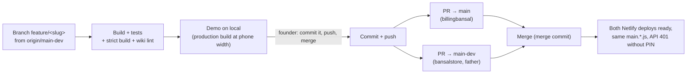

# Release process

The founder approves every step that leaves the machine ([D047](../decisions/D047-branch-demo-ship-workflow.md)).



## Steps

1. `git fetch origin && git switch -c feature/<slug> origin/main-dev`.
2. Make the change. **Update the wiki in the same branch**: decision records, affected pages, a `log.md` entry ([conventions](../conventions.md)).
3. Run the [checks](testing.md). Demo locally and tell the founder what was and wasn't tested.
4. Wait for the founder's words. Typical: "Commit it, push feature/<slug> and merge into both main and main-dev". Sometimes "merge into main so I can try it on billingbansal first" ([D009](../decisions/D009-two-sites-one-database.md)).
5. Commit with a message that explains *why*. End it with the co-author line the session asks for.
6. `git push -u origin feature/<slug>`, then:
   ```bash
   gh pr create --repo anubhavb11/Billing --base main     --head feature/<slug> --title "…"        --body-file pr.md
   gh pr create --repo anubhavb11/Billing --base main-dev --head feature/<slug> --title "… (main-dev)" --body-file pr.md
   gh pr merge <n> --repo anubhavb11/Billing --merge
   ```
7. Confirm both deploys are `ready` and serve the same bundle ([deployment](../architecture/deployment-and-environments.md#checking-a-deploy)).
8. Tell the founder what to try on the phone, and what agents couldn't check (for example real WhatsApp sharing).

## PR description template

```markdown
## What changes
- (what the father will see, in his words)

## Database
- (new columns or tables, all additive; old code keeps working)

## Checked
- N unit tests, `CI=true npm run build`, wiki lint
- Local production build at 375px: (screens)
- Not tested: (real phone sharing, …)
```

## Rules

- **Additive database changes only**: the two sites may run different code against one database for a while.
- **New API route**: add it to `config.path`, or Netlify returns 404.
- **Don't spend credits casually**: each production deploy costs Netlify credits. Batch small fixes.
- **Don't merge on a failing check.** If merging before Netlify's preview finishes (done for #16/#17), say so to the founder.
